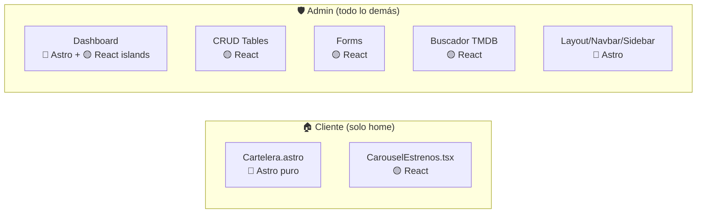

# 🏗️ Arquitectura Frontend — Astro + React (Islands)

## La regla de oro

> **Astro puro** → contenido estático, layouts, navegación, datos que solo se muestran
> **React (island)** → interactividad: formularios, tablas CRUD, carousels, modales

---

## 📁 Estructura de carpetas propuesta

```
src/
├── assets/
│   └── rutas.ts                     # URLs base (ya existe)
│
├── layouts/
│   ├── Layout.astro                 # Layout público (solo home)
│   └── AdminLayout.astro            # Layout admin (sidebar + navbar entidades)
│
├── components/
│   ├── common/                      # Compartidos
│   │   ├── Pagination.tsx           # 🟡 React — paginación interactiva
│   │   ├── Modal.tsx                # 🟡 React — abrir/cerrar modal
│   │   └── Cartelera.astro           # 🔵 Astro — grid de películas (recibe props)
│   │
│   ├── client/                      # Vista pública (solo home)
│   │   ├── CarouselEstrenos.tsx     # 🟡 React — carrusel con prev/next
│   │   └── Footer.astro             # 🔵 Astro — footer estático
│   │
│   └── admin/                       # Panel de administración
│       ├── Sidebar.astro            # 🔵 Astro — navegación estática
│       ├── AdminPanel.astro         # 🔵 Astro — tabs de entidades
│       ├── StatsCards.astro         # 🔵 Astro — cards recaudación
│       ├── DashboardSchedule.tsx    # 🟡 React — agenda diaria
│       ├── TopTaquillera.tsx        # 🟡 React — top películas
│       ├── Buscador.tsx             # 🟡 React — buscar en TMDB y agregar
│       │
│       ├── tables/                  # Tablas CRUD
│       │   ├── UsuariosTable.tsx    # 🟡 React
│       │   ├── SalasTable.tsx       # 🟡 React
│       │   ├── FuncionesTable.tsx   # 🟡 React
│       │   ├── PreciosTable.tsx     # 🟡 React
│       │   ├── VentasTable.tsx      # 🟡 React
│       │   └── EntradasTable.tsx    # 🟡 React
│       │
│       └── forms/                   # Formularios crear/editar
│           ├── UsuarioForm.tsx      # 🟡 React
│           ├── SalaForm.tsx         # 🟡 React
│           ├── FuncionForm.tsx      # 🟡 React
│           ├── PrecioForm.tsx       # 🟡 React
│           └── EntradaForm.tsx      # 🟡 React
│
├── pages/
│   ├── index.astro                  # 🔵 Home público (cartelera + carrusel)
│   │
│   └── admin/                       # ⚡ Todo el panel admin
│       ├── index.astro              # 🔵 Dashboard
│       ├── usuarios.astro           # 🔵 CRUD Usuarios
│       ├── cartelera.astro          # 🔵 CRUD Películas + Buscador TMDB
│       ├── salas.astro              # 🔵 CRUD Salas
│       ├── funciones.astro          # 🔵 CRUD Funciones
│       ├── precios.astro            # 🔵 CRUD Precios
│       ├── ventas.astro             # 🔵 CRUD Ventas
│       └── entradas.astro           # 🔵 CRUD Entradas
│
└── styles/
    └── global.css
```

---

## 🏠 Vista del cliente (solo home)

El cliente ve **una sola página**: el home con la cartelera fija y el carrusel.

### `Cartelera.astro` — Componente separado, recibe datos por props

```astro
---
// src/components/client/Cartelera.astro
import { imageBaseURL } from '../../assets/rutas';

interface Props {
  peliculas: any[];
}

const { peliculas } = Astro.props;
---

<section class="px-20 pb-10">
  <h1 class="text-3xl font-bold pt-6">Cartelera</h1>
  <div class="grid grid-cols-6 gap-4 mt-4">
    {peliculas.map((peli) => (
      <div class="flex flex-col items-center">
        {peli.Poster && !peli.Poster.includes('null') ? (
          
        ) : (
          <div class="w-full aspect-2/3 bg-[#161324] border border-secondary rounded-lg flex items-center justify-center">
            <span class="text-xs text-zinc-400">Sin imagen</span>
          </div>
        )}
        <h2 class="text-center mt-2 text-sm font-medium">{peli.Titulo}</h2>
        <p class="text-blue-400 text-xs">{peli.Generos || 'Sin géneros'}</p>
      </div>
    ))}
  </div>
</section>
```

### `index.astro` — Página limpia, solo orquesta

```astro
---
// src/pages/index.astro
import Layout from '../layouts/Layout.astro';
import CarouselEstrenos from '../components/client/CarouselEstrenos.tsx';
import Cartelera from '../components/client/Cartelera.astro';
import { baseURL } from '../assets/rutas';

// Fetch en el servidor → 0 JS al navegador
const res = await fetch(`${baseURL}/peliculas`);
const { data: peliculas } = await res.json();
---

<Layout>
  <CarouselEstrenos client:load />
  <Cartelera peliculas={peliculas} />
</Layout>
```

> [!TIP]
> El fetch se hace en la **página** (el orquestador) y se pasan los datos al componente como prop.
> `Cartelera.astro` solo se encarga de renderizar — no sabe de dónde vienen los datos.
> El carrusel sigue en React porque tiene estado de slide y botones ← →.

---

## 🛡️ Vista del admin (todo lo demás)

Todo lo que no sea el home público es admin: dashboard, CRUDs, buscador TMDB.

### Resumen de componentes

| Componente | Tipo | Justificación |
|---|---|---|
| **AdminLayout.astro** | 🔵 Astro | Shell HTML, no tiene estado |
| **AdminSidebar.astro** | 🔵 Astro | Links estáticos |
| **AdminNavbar.astro** | 🔵 Astro | Tabs `<a>`, el activo se calcula server-side |
| **StatsCards.astro** | 🔵 Astro | Muestra recaudación, se puede fetchear en servidor |
| **DashboardSchedule.tsx** | 🟡 React | Navegar fecha ←/→, lista dinámica |
| **TopTaquillera.tsx** | 🟡 React | Carrusel interactivo |
| **Buscador.tsx** | 🟡 React | Input + fetch TMDB + click agregar (admin) |
| **\*Table.tsx** | 🟡 React | Paginación, ver/editar/eliminar, modales |
| **\*Form.tsx** | 🟡 React | Inputs controlados, validación, submit |

---

## 📄 AdminLayout.astro

```astro
---
import AdminSidebar from '../components/admin/AdminSidebar.astro';
import AdminNavbar from '../components/admin/AdminNavbar.astro';
import '../styles/global.css';
---

<!doctype html>
<html lang="es">
  <head>
    <meta charset="utf-8" />
    <meta name="viewport" content="width=device-width" />
    <title>Cineverse — Admin</title>
  </head>
  <body class="bg-cine-glow text-text-main min-h-screen flex">
    <AdminSidebar />
    <div class="flex-1 flex flex-col">
      <AdminNavbar />
      <main class="flex-1 overflow-auto">
        <slot />
      </main>
    </div>
  </body>
</html>
```

---

## 📄 AdminNavbar.astro

```astro
---
const tabs = [
  { label: 'USUARIOS', href: '/admin/usuarios' },
  { label: 'CARTELERA', href: '/admin/cartelera' },
  { label: 'SALAS', href: '/admin/salas' },
  { label: 'FUNCIONES', href: '/admin/funciones' },
  { label: 'PRECIOS', href: '/admin/precios' },
  { label: 'VENTAS', href: '/admin/ventas' },
  { label: 'ENTRADA', href: '/admin/entradas' },
];
const currentPath = Astro.url.pathname;
---

<nav class="flex gap-2 px-6 py-3 bg-[#0e0c16]/60 border-b border-secondary/30">
  {tabs.map(tab => (
    <a
      href={tab.href}
      class:list={[
        'px-4 py-2 rounded-lg text-sm font-medium transition-all',
        currentPath.startsWith(tab.href)
          ? 'bg-primary text-white shadow-md shadow-primary/30'
          : 'bg-secondary/20 text-text-main hover:bg-secondary/40'
      ]}
    >
      {tab.label}
    </a>
  ))}
</nav>
```

---

## 📄 Página Admin Dashboard

```astro
---
// src/pages/admin/index.astro
import AdminLayout from '../../layouts/AdminLayout.astro';
import StatsCards from '../../components/admin/StatsCards.astro';
import DashboardSchedule from '../../components/admin/DashboardSchedule.tsx';
import TopTaquillera from '../../components/admin/TopTaquillera.tsx';
---

<AdminLayout>
  <div class="grid grid-cols-[280px_1fr] gap-6 p-6">
    <DashboardSchedule client:load />
    <div class="flex flex-col gap-6">
      <StatsCards />
      <TopTaquillera client:visible />
    </div>
  </div>
</AdminLayout>
```

---

## 📄 Página Admin Usuarios (CRUD)

```astro
---
// src/pages/admin/usuarios.astro
import AdminLayout from '../../layouts/AdminLayout.astro';
import UsuariosTable from '../../components/admin/tables/UsuariosTable.tsx';
---

<AdminLayout>
  <div class="p-6">
    <!-- Título + botones Exportar/Agregar van dentro del React island -->
    <UsuariosTable client:load />
  </div>
</AdminLayout>
```

---

## 🔒 Protección de rutas admin

```ts
// src/middleware.ts
import { defineMiddleware } from 'astro:middleware';

export const onRequest = defineMiddleware(async (context, next) => {
  if (context.url.pathname.startsWith('/admin')) {
    // Verificar token/sesión de admin
    // const token = context.cookies.get('token');
    // if (!token) return context.redirect('/login');
  }
  return next();
});
```

> [!IMPORTANT]
> La protección real va en el **backend** (JWT/session). El middleware es solo UX.

---

## Resumen visual



---

## Entidades → Vistas admin

| Entidad | Tab | Tabla | Formulario |
|---|---|---|---|
| `Usuario` | USUARIOS | `UsuariosTable.tsx` | `UsuarioForm.tsx` |
| `Pelicula` | CARTELERA | `PeliculasTable.tsx` | `PeliculaForm.tsx` + `Buscador.tsx` |
| `Sala` | SALAS | `SalasTable.tsx` | `SalaForm.tsx` |
| `Funcion` | FUNCIONES | `FuncionesTable.tsx` | `FuncionForm.tsx` |
| `Tipo_entrada` / `CategoriaFuncion` | PRECIOS | `PreciosTable.tsx` | `PrecioForm.tsx` |
| `Venta` | VENTAS | `VentasTable.tsx` | — (solo lectura) |
| `Entrada` | ENTRADA | `EntradasTable.tsx` | `EntradaForm.tsx` |
